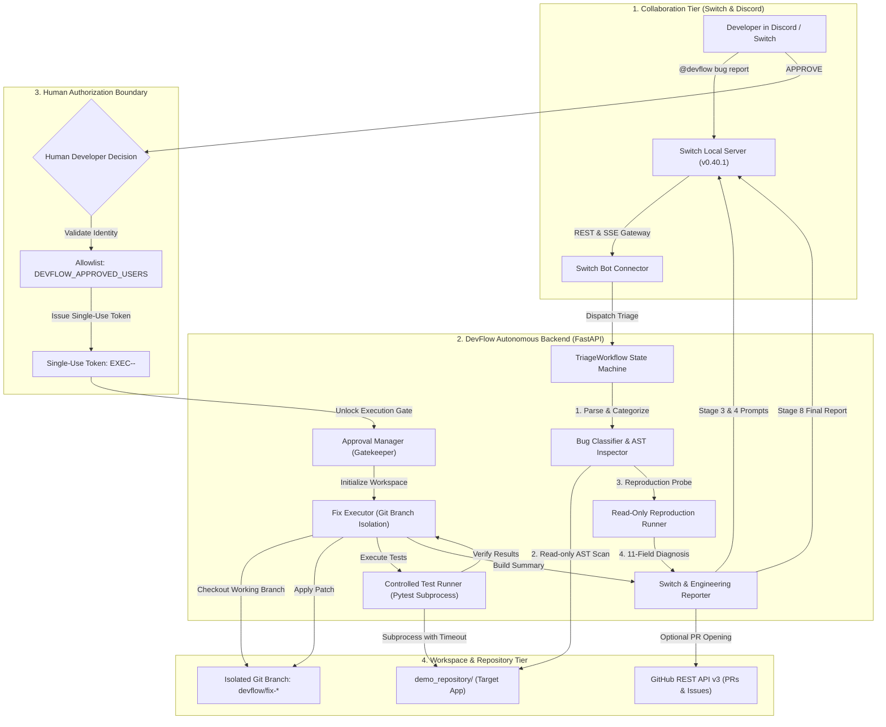

# DevFlow: Autonomous, Human-in-the-Loop Bug Investigation & Fix Agent

> **An autonomous software engineering teammate connected directly to team chat via Switch & Discord.**  
> Developed for the **SandboxAQ "Flip the Switch" Hackathon**.

[](https://www.python.org/downloads/)
[](https://fastapi.tiangolo.com)
[]()
[](https://switchboard.ai)
[](LICENSE)

---

## 1. Project Overview

**DevFlow** is an autonomous bug triage, investigation, and code fixing agent designed to operate inside team collaboration channels (Switch Console and Discord). When a developer reports a software bug or test failure in chat, DevFlow:

1. **Classifies & Triages**: Categorizes the bug into one of 8 standardized domains and assesses severity.
2. **Inspects Without Risk**: Parses the connected repository's syntax trees using Python AST in strict read-only mode.
3. **Probes Reproduction**: Runs reproduction test probes to isolate real stack traces, clearly distinguishing confirmed facts from hypotheses.
4. **Enforces Human-in-the-Loop Approval**: Physically halts at a server-side authorization gate. **Zero files can be modified without explicit approval from an authorized developer.**
5. **Fixes on Isolated Branches**: Checks out `devflow/fix-<issue_id>-<timestamp>`, never touching `main` directly.
6. **Validates with Pytest**: Executes regression test suites under hard subprocess timeout protection.
7. **Reports & Opens Pull Requests**: Publishes comprehensive engineering summaries across 8 lifecycle stages in chat and prepares human review-ready GitHub Pull Requests.

---

## 2. Problem Statement

Modern software engineering teams face three critical bottlenecks during incident response and bug fixing:

- **Context-Switching Drag**: Developers lose up to 30% of their working day toggling between team chat, issue trackers, IDEs, and CI/CD pipelines to reproduce bug reports.
- **Unsafe AI Coding Tools**: Existing autonomous coding agents either operate without permission controls (risking production corruption and directory traversal) or require cumbersome, manual terminal supervision.
- **Hallucinatory Diagnoses**: Many AI tools invent non-existent file paths, fabricate stack traces, or declare fixes "working" without running automated test suites.

**DevFlow solves this** by coupling autonomous AST repository exploration and automated testing with a cryptographically enforced, server-side human approval gate directly embedded in developer chat.

---

## 3. Key Features

- **8 Official Bug Categories**: Authentication, API failures, Database errors, Frontend issues, Validation errors, Performance problems, Dependency issues, and Unknown.
- **Standardized 11-Field Diagnostic Reports**: Issue ID, Title, Category, Severity, Description, Affected files, Relevant functions, Root cause (confirmed vs hypothesis), Evidence, Proposed solution, Testing strategy, and Potential risks.
- **Physical Human Approval Gate**: Server-side allowlist (`DEVFLOW_APPROVED_USERS`), single-use execution tokens (`EXEC-<nonce>`), 15-minute TTL expiration, and replay protection.
- **Git Branch Isolation**: Hard invariant prohibiting writes to `main`/`master`. Fixes are restricted strictly to isolated feature branches.
- **Automated Rollback Safeguard**: If test execution fails or times out, the working tree is automatically reverted to its clean baseline.
- **8-Stage Real-Time Chat Updates**: Progressive lifecycle updates keeping teams informed across bug receipt, diagnosis, approval, branch checkout, testing, and conclusion.
- **GitHub REST API v3 Integration**: Automated tracking issue creation and PR drafting with token masking and offline fallback.
- **Cross-Platform Collaboration**: Operates seamlessly inside Switch Console and bridged Discord channels (`#bug-reports`).

---

## 4. System Architecture



---

## 5. Technology Stack

| Layer | Component | Version | Description |
|---|---|---|---|
| **Runtime** | Python | 3.14.3 / 3.11+ | High-performance asynchronous language runtime |
| **API Framework** | FastAPI | 0.115.8 | Asynchronous backend API with automatic OpenAPI docs |
| **Data Validation** | Pydantic | 2.14.1 | Strict schema validation, serialization, and typing |
| **Web Server** | Uvicorn | 0.34.0 | ASGI web server |
| **HTTP Client** | HTTPX | 0.28.1 | Asynchronous client for GitHub API integration |
| **Test Runner** | Pytest | 9.2.0 | Automated unit, regression, and scenario testing |
| **Team Messaging** | Switch Console | 0.40.1 | Team orchestration hub and agent platform |
| **Chat Gateway** | Discord API | v10 | Live messaging connector into Discord channels |
| **Demo Application**| FastAPI + SQLite | - | Sample authentication service in `demo_repository/` |

---

## 6. Installation & Quickstart

### Step 1: Clone the Repository
```bash
git clone https://github.com/your-username/DevFlow.git
cd DevFlow
```

### Step 2: Create & Activate Virtual Environment
```bash
# Windows PowerShell
python -m venv .venv
.\.venv\Scripts\Activate.ps1

# macOS / Linux
python3 -m venv .venv
source .venv/bin/activate
```

### Step 3: Install Dependencies
```bash
pip install -r requirements.txt
```

---

## 7. Environment Configuration

Create a `.env` file in the project root:

```env
# Project Core
PROJECT_NAME="DevFlow"
VERSION="0.1.0"
ENVIRONMENT="development"
PORT=8000
LOG_LEVEL="INFO"
LOG_JSON=false

# Target Repository
DEVFLOW_REPO_PATH="./demo_repository"

# Human Approval Gate & Security
DEVFLOW_APPROVED_USERS="santhosh2302,lead_dev,alice_admin,admin"
DEVFLOW_APPROVAL_TIMEOUT_SECONDS=900
DEVFLOW_TEST_TIMEOUT_SECONDS=60

# GitHub Integration (Optional)
GITHUB_TOKEN=""
GITHUB_REPO="your-org/your-repo"
ENABLE_GITHUB_INTEGRATION=false
```

---

## 8. Connecting Switch Console & Discord

### Connect Switch Agent
1. Open **Switch Console** (`127.0.0.1:52774`).
2. Navigate to **Your Agents** &rarr; **+ Add Agent**.
3. Name the agent `devflow` and select the **Codex** or local model provider.
4. Set the agent instructions using the contents of `AGENTS.md`.

### Connect Discord
1. Go to [Discord Developer Portal](https://discord.com/developers/applications) &rarr; create application `DevFlow`.
2. Under **Bot**, enable **Server Members Intent** and **Message Content Intent**. Copy the Bot Token.
3. Under **OAuth2** &rarr; **URL Generator**, select `bot` scope and `Administrator` permissions. Open the URL to authorize DevFlow into your Discord server.
4. In Switch Console, go to **Admin** &rarr; **Connectors** &rarr; **+ Connect** &rarr; **Discord**.
5. Paste the Bot Token and your Discord **Guild ID** (Server ID).
6. Create room `bug-reports` mapped to Discord with participant `devflow`.

DevFlow will post in `#bug-reports`:
> *"Hey there! Tag @devflow if you need me."*

---

## 9. Running DevFlow

### Launch Backend Server
```bash
uvicorn app.main:app --app-dir backend --host 127.0.0.1 --port 8000 --reload
```
Interactive docs will be live at `http://127.0.0.1:8000/docs`.

### Run Automated Test Suite
```bash
pytest -v
```
All **62 automated tests** across configuration, investigation, approval, execution, reporting, and edge cases will execute and pass.

---

## 10. Reproducing the Hackathon Demonstration

To reproduce the exact 3-minute demonstration workflow:

1. **Trigger Bug Report**:
   Post in Discord `#bug-reports`:
   ```text
   @devflow Bug: The /auth/login endpoint crashes with HTTP 500 when credentials are invalid.
   ```
2. **Observe Autonomous Diagnosis**:
   DevFlow inspects `demo_repository/app/routers/auth.py` and posts the 11-field investigation report identifying unhandled `AuthenticationError`.
3. **Review Approval Prompt**:
   DevFlow posts approval request `APP-DF-001` with proposed patch and testing plan.
4. **Grant Human Approval**:
   Authorized developer replies:
   ```text
   APPROVE DF-001
   ```
5. **Witness Fix & Test Verification**:
   DevFlow checks out branch `devflow/fix-df-001-...`, applies the patch, runs `pytest`, and verifies `7/7 passed`.
6. **Inspect Final Engineering Report**:
   DevFlow publishes the comprehensive engineering report with git diff and opens a GitHub Pull Request.

*(See [`docs/DEMO_SCRIPT.md`](docs/DEMO_SCRIPT.md) for full second-by-second presentation timings).*

---

## 11. Known Limitations

- **Language Scope**: Currently optimized for Python projects (`pytest`, AST symbol parsing). Polyglot AST analysis (TypeScript, Go, Rust) is on the roadmap.
- **Single Target Workspace**: Fix execution is scoped to a single connected repository root at a time.
- **Subprocess Isolation**: Tests run in isolated child processes with timeout guards; production sandboxing will incorporate ephemeral Docker/gVisor microVMs.
- **Merge Restrictions**: DevFlow never automatically merges pull requests; human peer review and merge approvals remain strictly mandatory.

---

## 12. License & Acknowledgements

Developed under the MIT License for the **SandboxAQ "Flip the Switch" Hackathon**. Special thanks to the SandboxAQ and Switchboard teams for providing the Switch Agent platform.
