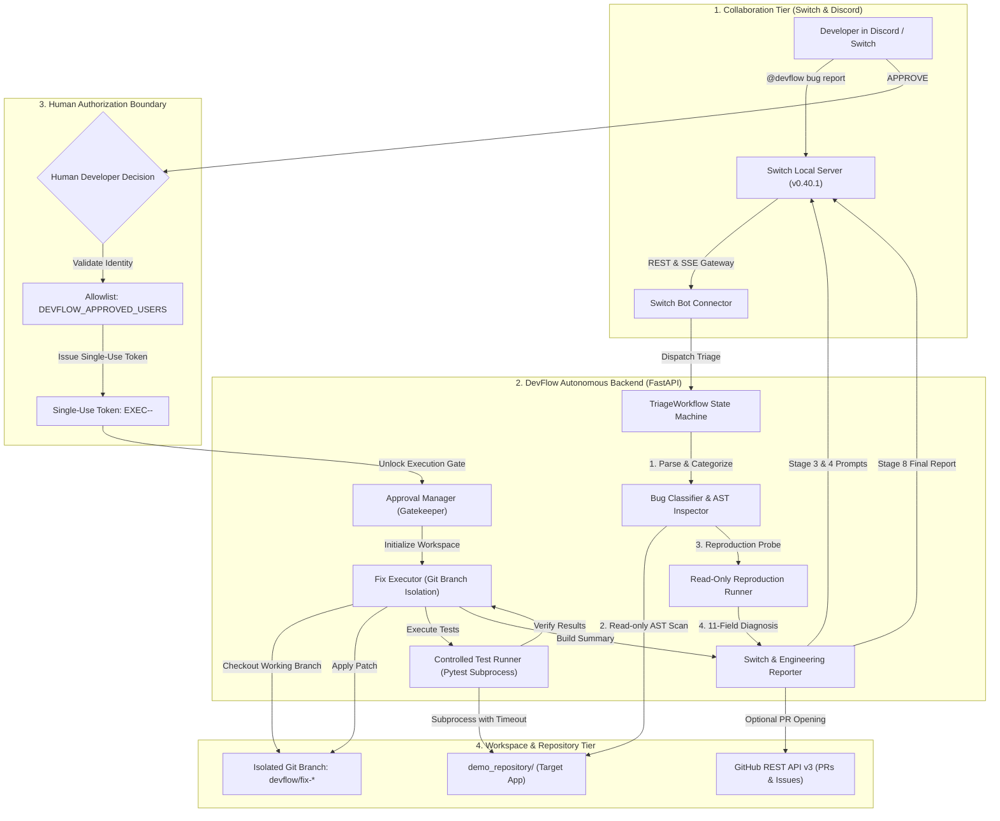
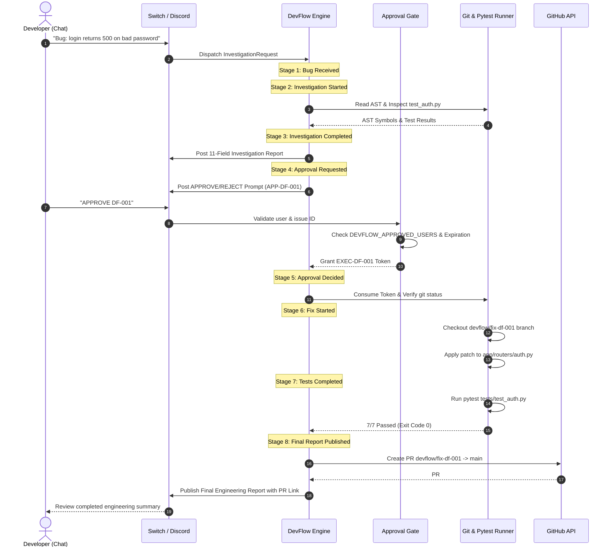

# DevFlow System Architecture

## 1. Executive Architecture Overview

DevFlow is an autonomous, human-in-the-loop software engineering agent built for the SandboxAQ "Flip the Switch" Hackathon. It integrates team chat platforms (Switch Console and Discord) directly with version control systems and local repositories to autonomously investigate bug reports, synthesize targeted patches, enforce a cryptographically secure approval gate, and run automated verification suites.

---

## 2. Core Subsystems

### 2.1 Collaboration & Messaging Layer
- **Switch Console (`v0.40.1`)**: Serves as the team collaboration hub, running on `127.0.0.1:52774`.
- **Discord Gateway Bridge**: Bridged via Switch's native Discord connector (`#bug-reports`), providing bi-directional webhook and websocket communications directly into developer chat rooms.
- **Codex Agent Worker**: Configured with autonomous reasoning instructions (`AGENTS.md`) to guide tool execution and report drafting.

### 2.2 Bug Investigation Engine (Phase 03)
The investigation engine conducts rigorous, read-only analysis without making any modifications to disk:
1. **Classifier (`BugClassifier`)**: Categorizes bugs into 8 official categories (`Authentication`, `API failures`, `Database errors`, `Frontend issues`, `Validation errors`, `Performance problems`, `Dependency issues`, `Unknown`) using heuristic pattern recognition and severity scoring.
2. **Repository Inspector (`RepositoryInspector`)**: Uses Python's native `ast` module to extract classes, functions, and imports from genuine repository files. Enforces directory traversal barriers to block unauthorized access outside the repository root.
3. **Reproduction Runner (`ReproductionRunner`)**: Probes existing test suites (`pytest`) in read-only mode to capture real stack traces and exit codes. Distinguishes confirmed facts from hypotheses.

### 2.3 Human Approval Gate (Phase 04)
A strict, server-side authorization barrier between diagnosis and code modification:
- **Zero-Write Invariant**: Not a single file can be created, modified, or deleted without a valid execution token.
- **Allowlist RBAC**: Validates sender against `DEVFLOW_APPROVED_USERS`. Chat messages from unauthorized accounts are strictly blocked.
- **Single-Use Execution Tokens**: Cryptographically random tokens (`EXEC-<issue_id>-<nonce>`) valid for 15 minutes. Automatically consumed upon branch creation to prevent replay attacks.
- **Persistent Audit Log**: All approvals, rejections, cancellations, and timestamps are persisted to `data/approvals.json`.

### 2.4 Controlled Code Fixing Engine (Phase 05)
1. **Pre-Flight Repository Verification**: Inspects `git status` to ensure working directory is clean before modifying files.
2. **Branch Isolation**: Never modifies `main` or `master` directly. Checkouts an isolated branch: `devflow/fix-<issue_id>-<timestamp>`.
3. **Workspace Boundary Enforcement**: Validates that all target paths remain strictly inside the authorized repository workspace.
4. **Controlled Subprocess Execution**: Pytest runs with explicit argument arrays, `shell=False`, and hard execution timeouts (default: 30s) to prevent hang conditions.
5. **Atomic Auto-Rollback**: If tests fail or timeout occurs, all uncommitted changes on the fix branch are automatically reverted, preserving the clean state of the target application.

### 2.5 Reporting & Version Control Integration (Phase 06)
- **8-Stage Switch Lifecycle**: Dispatches progressive updates (Bug received, Investigation started, Investigation completed, Approval requested, Approval decided, Fix started, Tests completed, Final summary).
- **GitHub Integration**: Direct REST API v3 client (`httpx`). Opens pull requests for human review and creates tracking issues with Switch backlinks. Rejects `main` as head branch and includes token masking and offline fallback.

---

## 3. End-to-End Sequence Diagram

---

## 4. Technology Stack

| Layer | Technology | Purpose |
|---|---|---|
| **Language** | Python 3.14.3 | Core runtime for backend, parser, and agents |
| **API Framework** | FastAPI 0.115.8 / Starlette | High-performance asynchronous REST API |
| **Data Validation** | Pydantic v2.14.1 | Schema validation, typing, and serialization |
| **Web Server** | Uvicorn 0.34.0 | ASGI web server |
| **HTTP Client** | HTTPX 0.28.1 | Asynchronous HTTP client for GitHub REST API |
| **Test Runner** | Pytest 9.2.0 | Automated unit, regression, and scenario testing |
| **Messaging & Agents** | Switch Console v0.40.1 | Team chat, agent orchestration, and Discord gateway |
| **Target App** | FastAPI + SQLite (Demo Repo) | Baseline sample application for bug scenarios |
